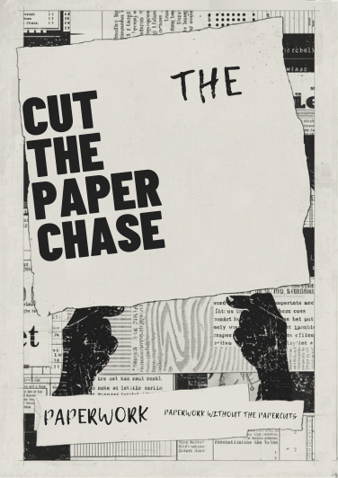
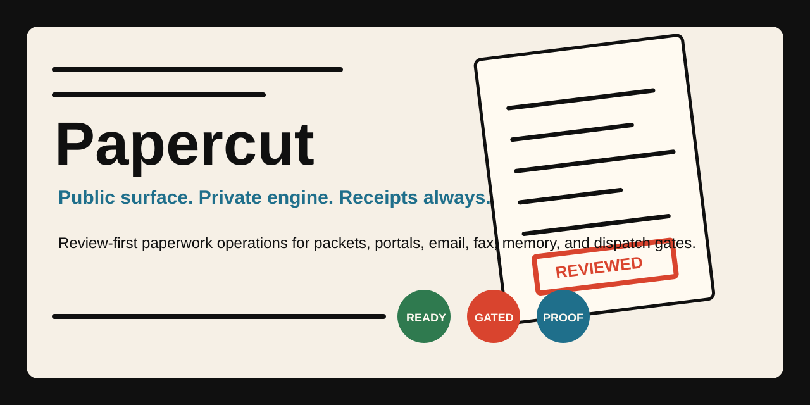
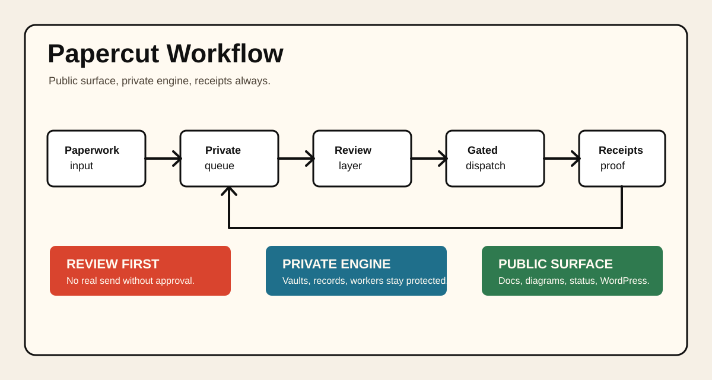
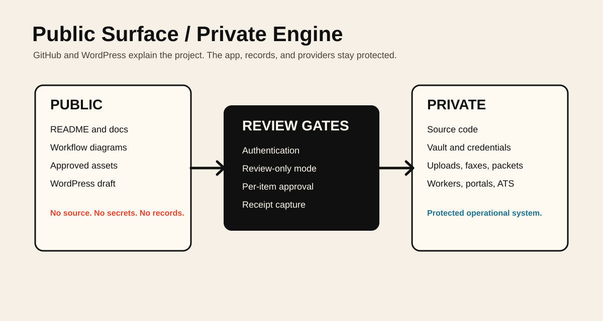
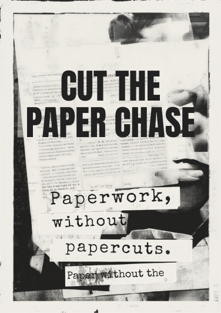
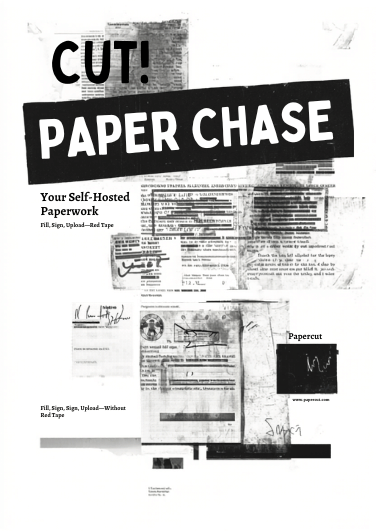

# Papercut

Papercut is a review-first paperwork operations system for recurring forms,
packets, signatures, portals, email, fax, workflow memory, and dispatch
receipts.

It is designed for people and organizations that need to do the same paperwork
work more than once without losing the human approval edge. Papercut prepares,
organizes, rehearses, and records the work. It does not treat automation as a
license to submit, send, fax, or apply without explicit review.

This repository is a protected public project surface. It is not the full source
code, operational system, private workflow, or data room.

## Why It Matters

Paperwork systems break people in small ways: missed deadlines, duplicate
uploads, stale portal status, missing signatures, forms stuck in email, and no
single record of what was actually prepared or submitted. Papercut treats those
details as an operating system, not an afterthought.

Papercut matters because it combines:

- document intake and packet preparation
- private profile memory for repeat answers
- review-copy preparation and signature reuse
- portal runbooks and supervised browser automation
- email, fax, portal, ATS, and worker dispatch readiness
- provider status checks and audit receipts
- a public product surface with a private engine behind it

## Who It Is For

Papercut is for builders, operators, student-support teams, case-support teams,
civic-tech projects, family administrators, founders, advocates, and service
providers who need high-trust paperwork operations with proof.

## How It Works

1. A person brings in a form, packet, deadline, portal task, or recurring
   administrative workflow.
2. Papercut groups the work into a private queue with documents, memory,
   runbooks, blockers, and next actions.
3. The operator reviews the packet, destination, provider readiness, and
   automation limits.
4. Approved work can be staged for email, fax, portal upload, status check, ATS
   apply, or worker dispatch.
5. Live sends remain gated by credentials, review mode, provider status, and
   per-item approval.
6. Every meaningful action leaves a receipt.

## Public Surface

The public materials may include:

- product overview
- workflow diagrams
- branded images and poster-style visuals
- public status notes
- commercial-use and ownership terms
- WordPress page draft for FaithCheltenham.com
- high-level roadmap and FAQ

## Private Engine

The private engine remains excluded:

- source code
- private prompts and agent instructions
- credentials and provider configuration
- customer, student, family, benefits, medical, or legal/admin records
- uploaded documents, packet artifacts, signatures, faxes, screenshots, and
  run histories
- deployment systems, worker tokens, vault data, and private indexes

## Current Status

Papercut is an active private product with a public share surface planned for:

- `https://faithcheltenham.com/papercutpublic`
- proposed project page: `https://faithcheltenham.com/projects/papercut/`

The working app uses a private app base path:

- `https://faithcheltenham.com/papercutprivate`

Live provider-backed dispatch remains intentionally guarded. Review-only mode,
SMTP readiness, Sinch fax readiness, portal worker readiness, ATS trust, and
per-item approval all matter.

## Safety Model

Papercut follows a public-surface/private-engine model:

- public demos never send real email, fax, portal, ATS, or worker actions
- authenticated routes hold real queues and provider readiness
- real dispatch requires credentials and per-item approval
- review-only mode can pause all live dispatch while preserving prep and review
- private data and artifacts remain outside this repository

## Visual Gallery

Papercut uses an owned Xerox/poster visual system: cut paper, review stamps,
proof marks, and workflow texture.

## Commercial Use

Papercut is proprietary software and a protected product surface owned by Faith
Cheltenham / XXYYZZ Society LLC unless superseded by a separate signed
agreement.

No source license is granted by this repository. No redistribution, commercial
reuse, model training, scraping, white-labeling, or operational replication is
permitted without written permission.

See:

- [License Notice](LICENSE.md)
- [Commercial Use Policy](docs/COMMERCIAL_USE_POLICY.md)
- [Public / Private Boundary](docs/PUBLIC_PRIVATE_BOUNDARY.md)
- [Security](SECURITY.md)

## Learn More

- GitHub repository: `https://github.com/thefayth/papercut`
- Public product route: `https://faithcheltenham.com/papercutpublic`
- Published project page: `https://faithcheltenham.com/projects/papercut/`
- WordPress source draft: `wordpress/page.md`
- Project status: `docs/STATUS.md`
- Roadmap: `docs/ROADMAP.md`
- Workflow diagrams: `docs/WORKFLOW_DIAGRAMS.md`
