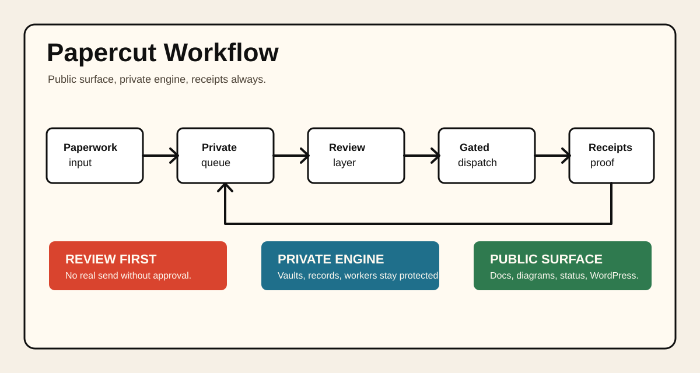
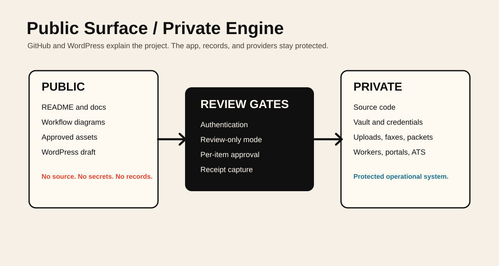

# Workflow Diagrams

Papercut uses public-safe diagrams to explain the product without exposing the
private engine.

## Workflow Overview

Source: `../assets/diagrams/workflow-overview.mmd`

This diagram shows the high-level paperwork path:

1. input arrives
2. private queue organizes the work
3. review layer checks readiness
4. dispatch channels remain gated
5. receipts become the durable output

## Public / Private Boundary

Source: `../assets/diagrams/public-private-boundary.mmd`

This diagram shows what belongs in the public repository and what remains in
the protected app, data room, vault, and deployment layer.

